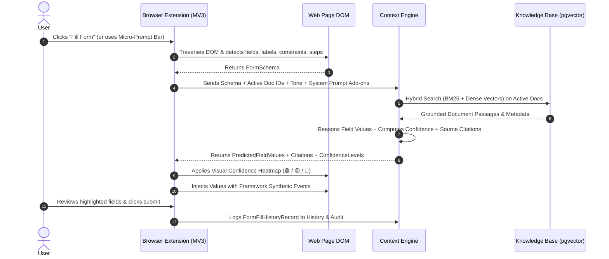
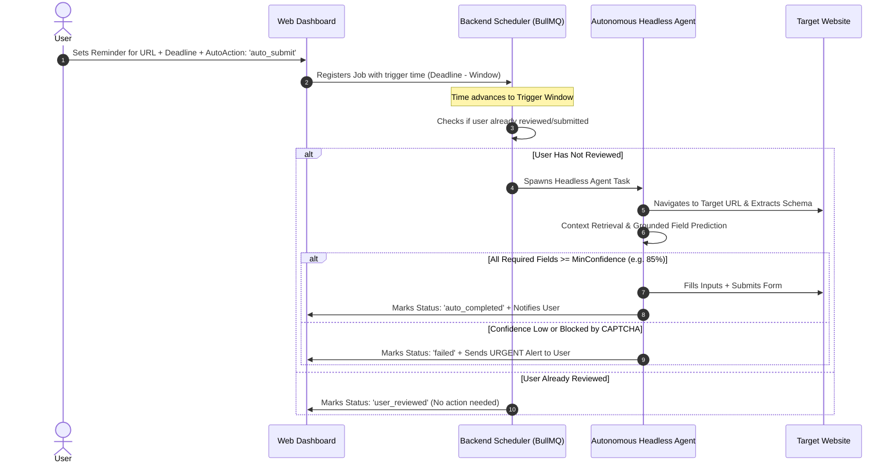

# FormPilot AI: System Architecture & Technical Specification

FormPilot AI is an autonomous, context-aware form-filling platform powered by a hybrid RAG (Retrieval-Augmented Generation) context engine, multi-agent fleet automation, and universal DOM reasoning.

---

## 1. System Topology Overview

```
+---------------------------------------------------------------------------------------------------+
|                                        USER INTERFACES                                            |
|                                                                                                   |
|  +---------------------------------------------+     +-----------------------------------------+  |
|  |           WEB APPLICATION DASHBOARD         |     |        BROWSER EXTENSION (MV3)          |  |
|  | - Knowledge Base (KB) Management            |     | - Floating In-Page Badge / Side Panel   |  |
|  | - Document Scope Toggles & Descriptions     |     | - Active Document On/Off Toggles        |  |
|  | - Form Filling Recorder & Audit Logs        |     | - Quick Link to Web KB Manager          |  |
|  | - Tone Customizer & System Prompt Add-ons   |     | - 1-Click "Fill Form" Action            |  |
|  | - Form Reminders & Auto-Action Rules        |     | - In-Page Micro-Prompt Bar              |  |
|  | - Bulk Multi-Site Form Queue Runner         |     | - Confidence Heatmap & Review Mode      |  |
|  | - AI Document Gap Recommendation Center     |     | - Multi-Step Form Navigator             |  |
|  +----------------------+----------------------+     +--------------------+--------------------+  |
|                         |                                                 |                       |
+-------------------------|-------------------------------------------------|-----------------------+
                          |                                                 |
                          v                                                 v
+---------------------------------------------------------------------------------------------------+
|                                  CORE BACKEND & CONTEXT ENGINE                                    |
|                                                                                                   |
|  +--------------------------------+  +--------------------------------+  +---------------------+  |
|  |   RAG & Document Intelligence  |  |    Agent Reasoning Engine      |  | Scheduler & Fleet   |  |
|  | - Multi-Format Parser & OCR    |  | - Universal DOM Parser         |  | - Cron Scheduler    |  |
|  | - Semantic Chunking & Vector DB|  | - Tone & Prompt Synthesizer    |  | - Deadline Monitor  |  |
|  | - Semantic Metadata Filtering  |  | - Grounded Field Prediction    |  | - Auto-Action Runner|  |
|  | - Document Gap Classifier      |  | - Dynamic Document Generator   |  | - Bulk Fleet Worker |  |
|  +--------------------------------+  +--------------------------------+  +---------------------+  |
|                                                                                                   |
|  +---------------------------------------------------------------------------------------------+  |
|  | Relational Database (PostgreSQL) + Vector Store (pgvector) + Job Queue (Redis/BullMQ)       |  |
|  +---------------------------------------------------------------------------------------------+  |
+---------------------------------------------------------------------------------------------------+
```

---

## 2. Core Components

### Component A: Central Web Application (Context Engine & Dashboard)

The Web Dashboard serves as the central control room for knowledge ingestion, agent behavior configuration, scheduling, bulk batch processing, and audit analytics.

#### 1. Knowledge Base (KB) Management
* **Multi-Format Ingestion**: Supports `.pdf`, `.docx`, `.txt`, `.csv`, `.json`, and scanned image OCR.
* **Document Enable/Disable Toggles**: Users can globally or conditionally toggle which documents are active in the context pool. Inactive documents are excluded from retrieval during form filling to minimize noise and token consumption.
* **Semantic Document Descriptions**: Each document includes an editable metadata description (e.g., *"2024 Form 1040 Tax Return showing AGI, dependents, and employer details"*). This enables the context engine to quickly pre-filter candidates before dense vector search.
* **Intelligent Document Gap Analysis**: Analyzes unfilled form fields or recurring missing questions across past submissions to recommend documents the user should upload (e.g., *"3 recent forms asked for your employment tax declaration; upload your W-2 to automate these fields"*).

#### 2. Form History & Audit Recorder
* **Submissions Log**: Persists every form interaction:
  * Domain & URL pattern.
  * Form structure and question labels.
  * Generated answers and user manual edits.
  * Timestamp, execution time, and confidence ratings.
* **Audit & Re-use**: Allows users to review past responses, export audit logs, and establish canonical answers for repeated question types across different portals.

#### 3. Agent Personality & Prompt Studio
* **Tone Presets**: Configurable tone profiles:
  * *Requesting*: Polite, formal, seeking approvals or assistance.
  * *Informative / Factual*: Objective, precise, concise, data-driven.
  * *Professional / Executive*: Polished, industry-aligned.
  * *Casual / Direct*: Straightforward, brief.
* **Custom System Prompt Add-ons**: User-specified custom directives injected into the reasoning prompt (e.g., *"Always prioritize remote work preference"*, *"Express dates in DD/MM/YYYY format"*, *"Emphasize 5 years of full-stack engineering experience"*).

#### 4. Website Form Reminders & Autonomous Auto-Action
* **Deadline Tracking**: Users configure reminders for specific form URLs with deadlines (e.g., scholarship deadlines, grant portals, visa slots, recurring timesheets).
* **Auto-Action Policies**:
  * `notify_only`: Sends proactive notifications (email, browser push, webhook) ahead of the deadline window.
  * `auto_fill_draft`: Pre-fills the form and stages it in the browser extension or headless draft state.
  * `auto_submit`: If the user has not manually reviewed/submitted the form before the deadline, an autonomous background worker navigates to the URL, validates fields against the Knowledge Base, checks if all required fields meet a user-defined confidence threshold (e.g., $\ge 85\%$), and automatically submits the form.
* **Safety & Review Thresholds**: Forms with confidence scores below the threshold or requiring human-only CAPTCHAs are marked for urgent manual intervention rather than failing silently.

#### 5. Bulk Multi-Site Form Queue Runner
* **Batch Request Creation**: Users paste a list of form URLs (e.g., 20 job applications on Greenhouse/Lever/Workday, 5 vendor registration portals).
* **Autonomous Fleet Orchestration**:
  * Background worker queue (powered by BullMQ/Redis and headless Playwright instances) spins up workers to process forms asynchronously.
  * Each worker visits the target URL, extracts the DOM schema, queries the Context Engine for grounded values, fills inputs, attaches generated or stored documents, and logs progress.
* **Real-Time Progress Dashboard**: Users watch live statuses (`queued`, `scanning`, `filled`, `submitted`, `failed`), review individual field results, and inspect bulk summary analytics.

---

### Component B: Browser Extension (Manifest V3)

The Browser Extension acts as the on-page operator that inspects web pages, interfaces with the user in context, and executes reliable DOM mutations.

#### 1. In-Page User Interface (Side Panel & Floating Pill)
* **Scope Selector**: Displays the list of all documents with active/inactive toggles, allowing instantaneous context switching without leaving the web page.
* **KB Manager Shortcut**: One-click navigation to open the full Knowledge Base dashboard in a new tab.
* **"Fill Form" Primary Action**: Initiates the full DOM inspection and autofill pipeline.
* **Extension Micro-Prompt Bar**: A floating conversational input bar directly on the page where users can issue natural language tweaks (e.g., *"Make answer 3 more concise"*, *"Emphasize Kubernetes leadership in the personal statement"*).

#### 2. Confidence Heatmap & Review System
* **Visual Confidence Badges**:
  * 🟢 **High Confidence ($\ge 90\%$)**: Direct match from verified documents.
  * 🟡 **Medium Confidence ($50\% - 89\%$)**: Inferred or partial match; flagged with amber highlight for user verification.
  * 🔴 **Low Confidence ($< 50\%$)**: Insufficient document data; highlighted in red with an inline suggestion to upload the missing document.
* **Interactive Citations**: Clicking any field reveals a tooltip with the exact source document, page, and excerpt from which the answer was derived.

#### 3. Multi-Step Form Navigator
* **Step Detection & Graph Traversal**: Detects multi-page application flows ("Step 1 of 4", "Next", "Continue", progress bars).
* **State Preservation**: Persists state across step transitions, handles client-side route changes in SPAs, validates the current step, and continues filling subsequent steps seamlessly.

#### 4. Document Upload & Dynamic Document Generator
* **File Upload Detection**: Identifies `<input type="file">` fields on web forms, parses requirements (e.g., *"Upload Resume in PDF"*), checks whether a matching document exists in your active KB, and prompts you to attach or upload the file.
* **On-the-Fly Document Synthesis**: If a form requires a tailored document (e.g., a custom cover letter addressing specific prompt questions on the page), the agent synthesizes a tailored markdown document, converts it to PDF on the fly, and prepares it for upload.

#### 5. DOM Ingestion & Framework Event Dispatcher
* **Universal Form Recognition**: Traverses the DOM to identify standard `<form>` elements and non-standard form structures (e.g., React/Vue component trees, `div[role="form"]`, shadow roots, and iframes).
* **Synthetic Event Cascade**: Simulates natural user interaction by dispatching `focus`, `keydown`, `input`, `change`, and `blur` events, utilizing native prototype property setters to ensure React, Angular, Vue, and Svelte state bindings are properly updated.

---

## 3. Autonomous Execution Flows

### Flow 1: Interactive In-Page Autofill with Heatmap & Review



### Flow 2: Form Reminder with Autonomous Action Fallback



---

## 4. Technology Stack Specification

| Layer | Recommended Technology | Purpose |
|---|---|---|
| **Dashboard Frontend** | Next.js 14+ (App Router), Tailwind CSS, shadcn/ui | Fast, accessible, and responsive web portal |
| **Extension Framework** | Vite + WXT (Web Extension Tools) or CRXJS | Manifest V3 compliance, TypeScript, HMR, cross-browser compatibility |
| **Backend API & Service** | Node.js (Fastify) or Python (FastAPI) | High-performance API for ingestion and reasoning orchestration |
| **Context Engine & AI** | Gemini 1.5 Pro / Flash via Google GenAI SDK | Long-context document reasoning, structured JSON outputs, multimodal analysis |
| **Vector & Metadata DB** | PostgreSQL with `pgvector` & Prisma ORM | Unified relational storage for KB metadata, users, history, and embeddings |
| **Task Queue & Scheduler** | Redis + BullMQ | Background scheduling for Form Reminders & Bulk Multi-Site Agent Fleet |
| **Autonomous Agent Fleet** | Playwright / Puppeteer Headless Worker Pool | Executes automated background filling and bulk operations |
| **Document Processing** | Unstructured.io / pdf-parse / Tesseract OCR / PDFKit | Robust document chunking, text extraction, and PDF generation |
